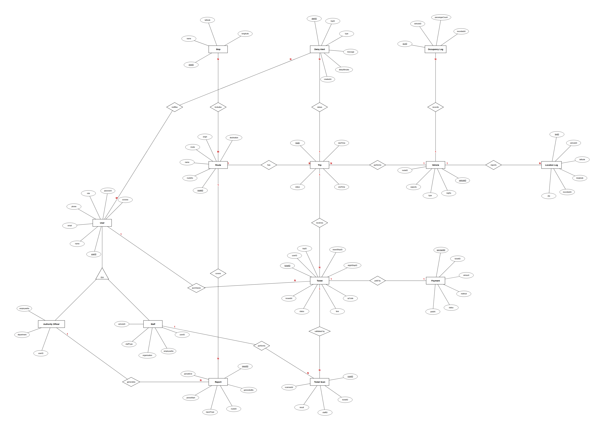

# Entity-Relationship Diagram

The ER diagram uses **Chen notation**: rectangles are entities, ovals are attributes (underlined = primary key), diamonds are relationships, and the triangle is an ISA (specialisation). `1`, `M` and `N` mark relationship cardinality.

Editable source: [`er-diagram.drawio`](diagrams/er-diagram.drawio) · PDF: [`er-diagram.pdf`](diagrams/er-diagram.pdf)

## Entities

| Entity | Purpose |
|---|---|
| **User** | Any registered account. `role` distinguishes passengers, staff and authority officers. |
| **Staff** | Specialisation of User: conductors and train ticket inspectors. |
| **Authority Officer** | Specialisation of User: transport authority back-office users. |
| **Route** | A bus or train route (e.g. origin → destination). |
| **Stop** | A bus stop or railway station with coordinates. |
| **Vehicle** | A bus or train serving a route. |
| **Trip** | One run of a vehicle on a route at a given time. |
| **Ticket** | A digital QR ticket for a trip. |
| **Payment** | Payment record for a ticket. |
| **Ticket Scan** | A validation event when staff scan a ticket. |
| **Delay Alert** | A delay, cancellation or route-change notice for a trip. |
| **Location Log** | Time-stamped GPS positions and ETA for a vehicle. |
| **Occupancy Log** | Time-stamped passenger counts for a vehicle. |
| **Report** | Generated route performance, delay and occupancy reports. |

## Relationships

| Relationship | Entities | Cardinality | Notes |
|---|---|---|---|
| ISA | User → Staff, Authority Officer | specialisation | Staff and officers are users with extra attributes |
| purchases | User — Ticket | 1 : N | A user buys many tickets |
| receives | Trip — Ticket | 1 : N | A ticket is valid for one trip |
| paid by | Ticket — Payment | 1 : 1 | Each ticket has one payment |
| validated by | Ticket — Ticket Scan | 1 : N | A ticket can be scanned more than once (e.g. invalid retries) |
| performs | Staff — Ticket Scan | 1 : N | Staff perform scans |
| has | Route — Trip | 1 : N | |
| performs | Vehicle — Trip | 1 : N | |
| includes | Route — Stop | M : N | A route has many stops; a stop is on many routes |
| reports | Vehicle — Location Log | 1 : N | |
| records | Vehicle — Occupancy Log | 1 : N | |
| raises | Trip — Delay Alert | 1 : N | |
| notifies | Delay Alert — User | M : N | Alerts reach many users; a user receives many alerts |
| covers | Route — Report | 1 : N | |
| generates | Authority Officer — Report | 1 : N | |

## Data dictionary

`PK` primary key · `FK` foreign key · `UK` unique

### User
| Attribute | Key | Description |
|---|---|---|
| userID | PK | Unique identifier |
| name | | Full name |
| email | UK | Login / contact email |
| phone | | Mobile number |
| role | | PASSENGER, STAFF or AUTHORITY |
| password | | Stored as a secure hash (never plain text) |
| isActive | | Whether the account is enabled |

### Staff
| Attribute | Key | Description |
|---|---|---|
| userID | PK, FK → User | |
| employeeNo | | Staff employee number |
| organisation | | e.g. NTC, Sri Lanka Railways, private operator |
| staffType | | CONDUCTOR or INSPECTOR |
| vehicleID | FK → Vehicle | Vehicle currently assigned |

### Authority Officer
| Attribute | Key | Description |
|---|---|---|
| userID | PK, FK → User | |
| department | | Department / unit |
| employeeNo | | Employee number |

### Route
| Attribute | Key | Description |
|---|---|---|
| routeID | PK | |
| routeNo | | Public route number |
| name | | Route name |
| mode | | BUS or TRAIN |
| origin | | Start point |
| destination | | End point |

### Stop
| Attribute | Key | Description |
|---|---|---|
| stopID | PK | |
| name | | Stop / station name |
| latitude | | |
| longitude | | |

### Vehicle
| Attribute | Key | Description |
|---|---|---|
| vehicleID | PK | |
| regNo | | Registration number |
| type | | BUS or TRAIN |
| capacity | | Passenger capacity |
| routeID | FK → Route | Route served |

### Trip
| Attribute | Key | Description |
|---|---|---|
| tripID | PK | |
| startTime | | Scheduled/actual start |
| endTime | | Scheduled/actual end |
| status | | SCHEDULED, ONGOING, DELAYED, CANCELLED, COMPLETED |

### Ticket
| Attribute | Key | Description |
|---|---|---|
| ticketID | PK | |
| userID | FK → User | Purchaser |
| tripID | FK → Trip | Trip the ticket is valid for |
| boardStopID | FK → Stop | Boarding stop |
| alightStopID | FK → Stop | Alighting stop |
| qrCode | UK | Encoded QR payload |
| fare | | Ticket price |
| status | | ACTIVE, USED or EXPIRED |
| issuedAt | | Purchase time |

### Payment
| Attribute | Key | Description |
|---|---|---|
| paymentID | PK | |
| ticketID | FK → Ticket | |
| amount | | |
| method | | Payment method |
| status | | PAID, FAILED or REFUNDED |
| paidAt | | |

### Ticket Scan
| Attribute | Key | Description |
|---|---|---|
| scanID | PK | |
| ticketID | FK → Ticket | |
| staffID | FK → Staff | Who scanned |
| result | | VALID, INVALID or MANUAL_ID |
| scannedAt | | |

### Delay Alert
| Attribute | Key | Description |
|---|---|---|
| alertID | PK | |
| tripID | FK → Trip | |
| type | | DELAY, CANCELLATION or ROUTE_CHANGE |
| message | | Text shown to passengers |
| delayMinutes | | Length of delay |
| createdAt | | |

### Location Log
| Attribute | Key | Description |
|---|---|---|
| logID | PK | |
| vehicleID | FK → Vehicle | |
| latitude / longitude | | GPS position |
| recordedAt | | Timestamp |
| eta | | Estimated arrival time |

### Occupancy Log
| Attribute | Key | Description |
|---|---|---|
| occID | PK | |
| vehicleID | FK → Vehicle | |
| passengerCount | | Passengers on board |
| recordedAt | | Timestamp |

### Report
| Attribute | Key | Description |
|---|---|---|
| reportID | PK | |
| generatedBy | FK → Authority Officer | |
| routeID | FK → Route | Route covered (optional) |
| reportType | | ROUTE, DELAY or OCCUPANCY |
| periodStart / periodEnd | | Reporting period |

## Implementation notes

- The M : N relationships (`Route — Stop`, `Delay Alert — User`) need **junction tables** in a relational database, e.g. `route_stop(routeID, stopID, stopSequence, fareFromOrigin)` and `alert_recipient(alertID, userID, isRead, sentAt)`.
- The ISA is typically implemented as `staff` and `authority_officer` tables whose primary key is also a foreign key to `user`.
- A passenger's trip history (FR11) is derived from their tickets and payments; there is no separate history table.
