# Data Flow Diagrams

Notation (Yourdon / DeMarco): rectangles are **external entities**, circles are **processes**, open-ended rectangles are **data stores**, arrows are **data flows**.

## Level 0 — Context diagram

The whole system is one process interacting with five external entities.

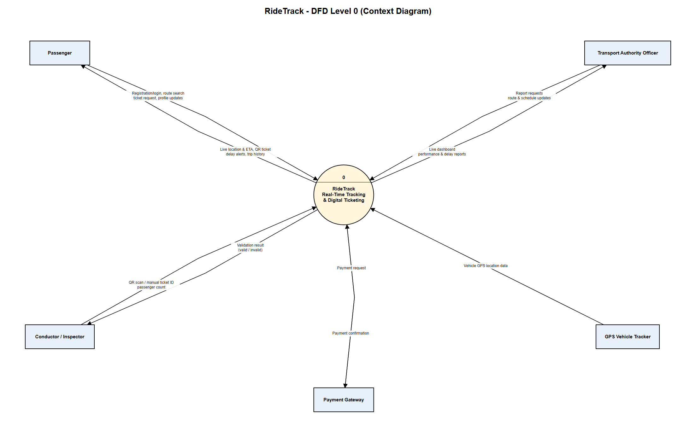

| External entity | Sends to RideTrack | Receives from RideTrack |
|---|---|---|
| Passenger | Registration/login details, route search, ticket request, profile updates | Live location & ETA, QR ticket, delay alerts, trip history |
| Conductor / Inspector | QR scan or manual ticket ID, passenger count | Validation result (valid / invalid) |
| Transport Authority Officer | Report requests, route & schedule updates | Live dashboard, performance & delay reports |
| GPS Vehicle Tracker | Vehicle GPS location data | — |
| Payment Gateway | Payment confirmation | Payment request |

## Level 1

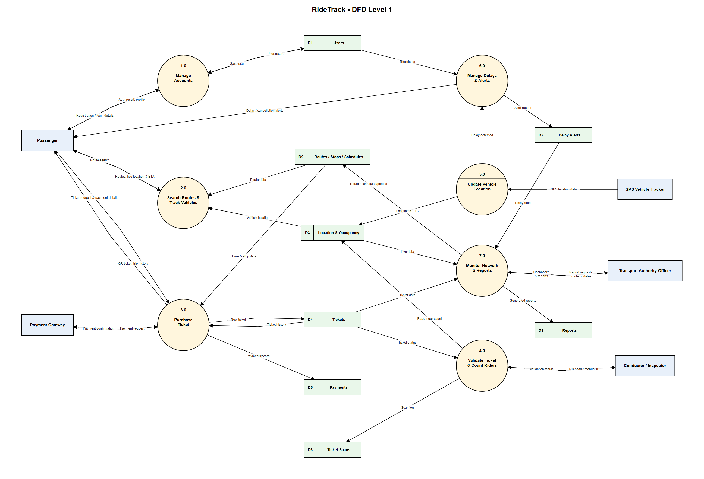

Editable source for all levels: [`dfd.drawio`](diagrams/dfd.drawio) (fifteen pages) · PDF: [`dfd.pdf`](diagrams/dfd.pdf)

### Processes

| ID | Process | Description |
|---|---|---|
| 1.0 | Manage Accounts | Registers users, authenticates logins, maintains profiles and preferences |
| 2.0 | Search Routes & Track Vehicles | Finds routes and shows live vehicle location and ETA |
| 3.0 | Purchase Ticket | Takes a ticket request, processes payment, issues a QR ticket, returns trip history |
| 4.0 | Validate Ticket & Count Riders | Validates scanned QR tickets, logs scans, records passenger counts |
| 5.0 | Update Vehicle Location | Receives GPS data, updates location and ETA, detects delays |
| 6.0 | Manage Delays & Alerts | Records delay/cancellation alerts and sends them to passengers |
| 7.0 | Monitor Network & Reports | Operations dashboard and report generation for authority users |

### Data stores

| ID | Data store | Main contents |
|---|---|---|
| D1 | Users | Accounts, roles, preferences |
| D2 | Routes / Stops / Schedules | Route, stop and timetable data |
| D3 | Location & Occupancy | Vehicle positions, ETAs, passenger counts |
| D4 | Tickets | Issued QR tickets and their status |
| D5 | Payments | Payment records |
| D6 | Ticket Scans | Validation log |
| D7 | Delay Alerts | Delay, cancellation and route-change alerts |
| D8 | Reports | Generated reports |

### Data flows

| From | To | Data |
|---|---|---|
| Passenger | 1.0 | Registration / login / profile updates |
| 1.0 | Passenger | Authentication result, profile |
| 1.0 ⇄ D1 | | Save user / user record |
| Passenger | 2.0 | Route search |
| 2.0 | Passenger | Routes, live location, ETA & occupancy |
| D2 | 2.0 | Route data |
| D3 | 2.0 | Vehicle location & occupancy |
| Passenger | 3.0 | Ticket request & payment details |
| 3.0 | Passenger | QR ticket, trip history |
| D2 | 3.0 | Fare & stop data |
| D4 | 3.0 | Ticket history |
| 3.0 ⇄ Payment Gateway | | Payment request / payment confirmation |
| 3.0 | D4 | New ticket |
| 3.0 | D5 | Payment record |
| GPS Vehicle Tracker | 5.0 | GPS location data |
| D2 | 5.0 | Schedule data |
| 5.0 | D3 | Location & ETA |
| 5.0 | 6.0 | Delay detected |
| D1 | 6.0 | Alert recipients |
| 6.0 | D7 | Alert record |
| 6.0 | Passenger | Delay / cancellation alerts |
| Passenger | 6.0 | Alert history request |
| Authority Officer | 6.0 | Manual alert |
| D7 | 6.0 | Alert records |
| Conductor / Inspector | 4.0 | QR scan / manual ID, passenger count |
| 4.0 | Conductor / Inspector | Validation result |
| D4 | 4.0 | Ticket status |
| 4.0 | D4 | Mark ticket used |
| 4.0 | D6 | Scan log |
| 4.0 | D3 | Passenger count |
| Authority Officer | 7.0 | Report requests, route updates |
| 7.0 | Authority Officer | Dashboard & reports |
| D3, D4, D7 | 7.0 | Live data, ticket data, delay data |
| D2 | 7.0 | Route data |
| 7.0 | D2 | Route / schedule updates |
| 7.0 | D8 | Generated reports |

## Level 2 — Process 3.0 Purchase Ticket

Process 3.0 is expanded into five sub-processes. This covers FR5 (buy a QR ticket) and FR11 (trip history).

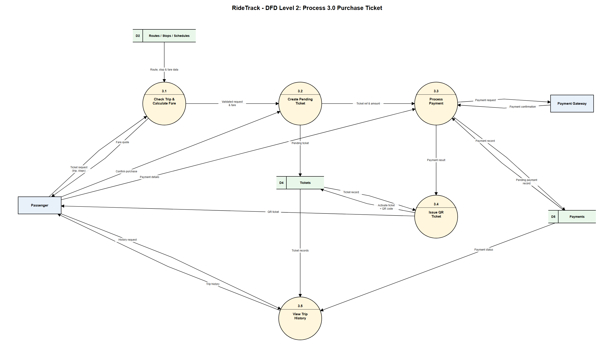

Editable source: page 3 of [`dfd.drawio`](diagrams/dfd.drawio) · PDF: page 3 of [`dfd.pdf`](diagrams/dfd.pdf)

### Sub-processes

| ID | Sub-process | Description |
|---|---|---|
| 3.1 | Check Trip & Calculate Fare | Receives the ticket request (trip, boarding and alighting stops), checks the trip, looks up fares in D2 and returns a fare quote |
| 3.2 | Create Pending Ticket | On the passenger's confirmation, stores a `PENDING` ticket in D4 |
| 3.3 | Process Payment | Sends the payment request to the gateway, receives the confirmation, records the payment in D5 |
| 3.4 | Issue QR Ticket | On successful payment, activates the ticket, generates its QR code, stores it in D4 and returns it to the passenger |
| 3.5 | View Trip History | Returns the passenger's past tickets and payment status from D4 and D5 |

### Data flows

| From | To | Data |
|---|---|---|
| Passenger | 3.1 | Ticket request (trip, stops) |
| 3.1 | Passenger | Fare quote |
| D2 | 3.1 | Route, stop & fare data |
| 3.1 | 3.2 | Validated request & fare |
| Passenger | 3.2 | Confirm purchase |
| 3.2 | D4 | Pending ticket |
| 3.2 | 3.3 | Ticket reference & amount |
| Passenger | 3.3 | Payment details |
| 3.3 ⇄ Payment Gateway | | Payment request / payment confirmation |
| 3.3 | D5 | Payment record |
| D5 | 3.3 | Pending payment record |
| 3.3 | 3.4 | Payment result |
| 3.4 ⇄ D4 | | Activate ticket + QR code / ticket record |
| 3.4 | Passenger | QR ticket |
| Passenger | 3.5 | History request |
| D4 | 3.5 | Ticket records |
| D5 | 3.5 | Payment status |
| 3.5 | Passenger | Trip history |

### Balancing with Level 1

Everything entering or leaving process 3.0 in Level 1 appears in Level 2: the passenger's request and payment details, the QR ticket and trip history returned to them, the payment gateway exchange, reads from D2 and D4, and writes to D4 and D5. Level 2 adds only internal flows between 3.1–3.5, plus the fare quote shown to the passenger before they confirm.

> Level 1 was updated to include two reads by process 3.0 that Level 2 needs: `D2 → 3.0` (fare & stop data) and `D4 → 3.0` (ticket history).

Sub-process 3.3 Process Payment is expanded further in the [Level 3 diagram](#level-3--sub-process-33-process-payment-ticket-purchase) below. That diagram also needs 3.3 to read the pending payment from D5, so the Level 2 diagram shows a `D5 → 3.3` flow.

## Level 2 — Process 4.0 Validate Ticket & Count Riders

Process 4.0 is expanded into five sub-processes. This covers FR6 (scan and validate QR tickets) and FR7 (passenger occupancy).

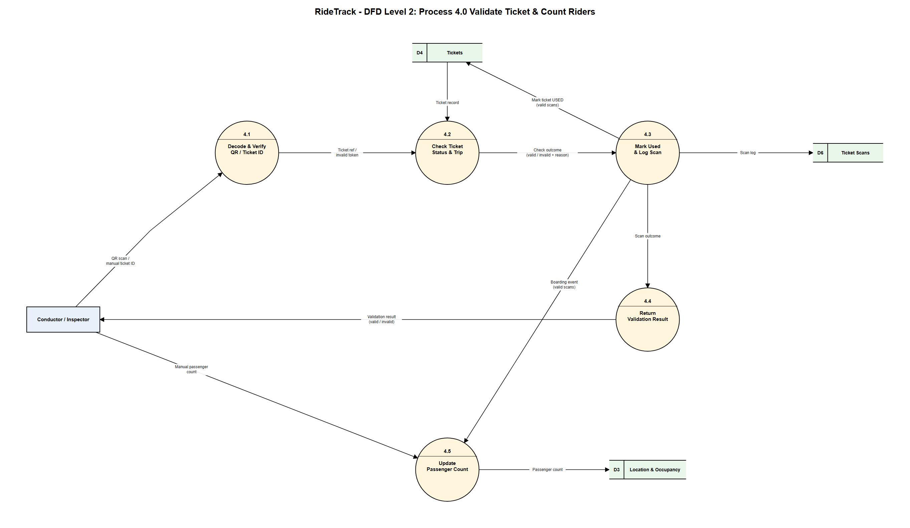

Editable source: page 4 of [`dfd.drawio`](diagrams/dfd.drawio) · PDF: page 4 of [`dfd.pdf`](diagrams/dfd.pdf)

### Sub-processes

| ID | Sub-process | Description |
|---|---|---|
| 4.1 | Decode & Verify QR / Ticket ID | Reads the scanned QR (or manually entered ticket ID) and checks its signature and format |
| 4.2 | Check Ticket Status & Trip | Looks the ticket up in D4 and checks it exists, is `ACTIVE`, not expired, and matches the vehicle's trip |
| 4.3 | Mark Used & Log Scan | Marks a valid ticket `USED` in D4 and writes every scan (valid or invalid) to D6 |
| 4.4 | Return Validation Result | Sends **VALID** / **INVALID** (with reason) to the conductor or inspector |
| 4.5 | Update Passenger Count | Updates on-board count in D3 from valid boardings and any manual count entered by staff |

### Data flows

| From | To | Data |
|---|---|---|
| Conductor / Inspector | 4.1 | QR scan / manual ticket ID |
| 4.1 | 4.2 | Ticket reference, or invalid token |
| D4 | 4.2 | Ticket record |
| 4.2 | 4.3 | Check outcome (valid / invalid + reason) |
| 4.3 | D4 | Mark ticket USED (valid scans only) |
| 4.3 | D6 | Scan log |
| 4.3 | 4.4 | Scan outcome |
| 4.4 | Conductor / Inspector | Validation result |
| 4.3 | 4.5 | Boarding event (valid scans) |
| Conductor / Inspector | 4.5 | Manual passenger count |
| 4.5 | D3 | Passenger count |

### Balancing with Level 1

Everything entering or leaving process 4.0 in Level 1 appears in Level 2: the staff scan and passenger count, the validation result returned to staff, the read of D4, and the writes to D4, D6 and D3. Level 2 adds only the internal flows between 4.1–4.5.

> Level 1 was updated for this: the staff input is now labelled "QR scan / manual ID, passenger count" (matching Level 0), and a `4.0 → D4` flow, "Mark ticket used", was added.

An unreadable QR or unknown ticket ID is treated as an `INVALID` outcome at 4.2, so it is still logged to D6 (`ticket_id` is nullable in the [database](06-database-mysql.md) for this reason).

## Level 2 — Process 5.0 Update Vehicle Location

Process 5.0 is expanded into five sub-processes. This covers the live tracking pipeline behind FR4 (live location and ETA), and the automatic delay detection behind FR8, within the 5-second update target of NFR2.

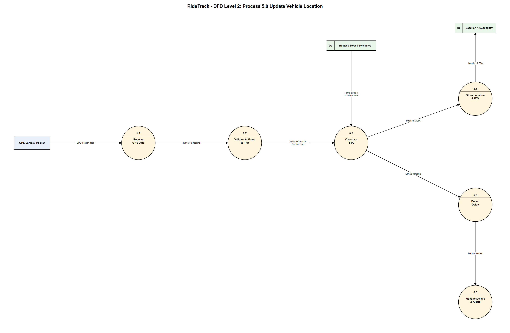

Editable source: page 10 of [`dfd.drawio`](diagrams/dfd.drawio) · PDF: page 10 of [`dfd.pdf`](diagrams/dfd.pdf)

### Sub-processes

| ID | Sub-process | Description |
|---|---|---|
| 5.1 | Receive GPS Data | Accepts position readings from the vehicle's GPS tracker |
| 5.2 | Validate & Match to Trip | Checks the reading (known vehicle, plausible coordinates, recent timestamp) and matches it to the vehicle's current trip |
| 5.3 | Calculate ETA | Uses the validated position with the route's stops and schedule (D2) to estimate arrival times |
| 5.4 | Store Location & ETA | Saves the position and ETA to D3; the backend also pushes it to passengers watching that route over WebSocket |
| 5.5 | Detect Delay | Compares the ETA with the schedule; when a trip is late beyond a threshold, signals process 6.0 |

### Data flows

| From | To | Data |
|---|---|---|
| GPS Vehicle Tracker | 5.1 | GPS location data |
| 5.1 | 5.2 | Raw GPS reading |
| 5.2 | 5.3 | Validated position (vehicle, trip) |
| D2 | 5.3 | Route stops & schedule data |
| 5.3 | 5.4 | Position & ETA |
| 5.4 | D3 | Location & ETA |
| 5.3 | 5.5 | ETA vs schedule |
| 5.5 | 6.0 Manage Delays & Alerts | Delay detected |

### Balancing with Level 1

Everything entering or leaving process 5.0 in Level 1 appears in Level 2: the GPS data in, the write to D3, and the "delay detected" signal to 6.0. Process 6.0 is drawn at the edge of the diagram because it is the neighbouring process that receives that signal; its internals are in the [Level 2 for alerts](#level-2--process-60-manage-delays--alerts).

> Level 1 was updated for this: a `D2 → 5.0` flow, "Schedule data", was added, since ETA and delay calculations need the route schedule.

Readings that fail validation at 5.2 are dropped and do not reach D3.

## Level 2 — Process 2.0 Search Routes & Track Vehicles (route search)

Process 2.0 is expanded into four sub-processes. This covers FR3 (search routes, upcoming arrivals), FR4 (live location and ETA) and FR7 (occupancy display).

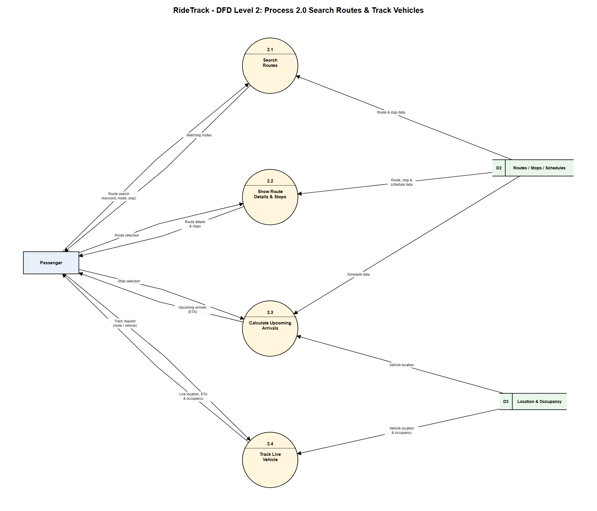

Editable source: page 9 of [`dfd.drawio`](diagrams/dfd.drawio) · PDF: page 9 of [`dfd.pdf`](diagrams/dfd.pdf)

### Sub-processes

| ID | Sub-process | Description |
|---|---|---|
| 2.1 | Search Routes | Finds routes matching a keyword, mode (bus / train) or stop, using route and stop data in D2 |
| 2.2 | Show Route Details & Stops | Returns the selected route's ordered stops and schedule from D2 |
| 2.3 | Calculate Upcoming Arrivals | For a chosen stop, combines schedules (D2) with current vehicle positions (D3) to give upcoming arrivals with ETA |
| 2.4 | Track Live Vehicle | Returns the live location, ETA and occupancy of vehicles on a route from D3; in the app this is pushed continuously over WebSocket |

### Data flows

| From | To | Data |
|---|---|---|
| Passenger | 2.1 | Route search (keyword, mode, stop) |
| 2.1 | Passenger | Matching routes |
| D2 | 2.1 | Route & stop data |
| Passenger | 2.2 | Route selection |
| 2.2 | Passenger | Route details & stops |
| D2 | 2.2 | Route, stop & schedule data |
| Passenger | 2.3 | Stop selection |
| 2.3 | Passenger | Upcoming arrivals (ETA) |
| D2 | 2.3 | Schedule data |
| D3 | 2.3 | Vehicle location |
| Passenger | 2.4 | Track request (route / vehicle) |
| 2.4 | Passenger | Live location, ETA & occupancy |
| D3 | 2.4 | Vehicle location & occupancy |

### Balancing with Level 1

Everything entering or leaving process 2.0 in Level 1 appears in Level 2: the passenger's search, the routes and live information returned to them, and the reads from D2 and D3. Process 2.0 only reads data stores, so there are no writes.

> Level 1 was updated for this: the output to the passenger now reads "Routes, live location, ETA & occupancy" and the D3 input reads "Vehicle location & occupancy", so occupancy (FR7) is visible there.

## Level 2 — Process 1.0 Manage Accounts (user accounts)

Process 1.0 is expanded into four sub-processes. This covers FR1 (register), FR2 (secure login) and FR12 (update profile and preferences).

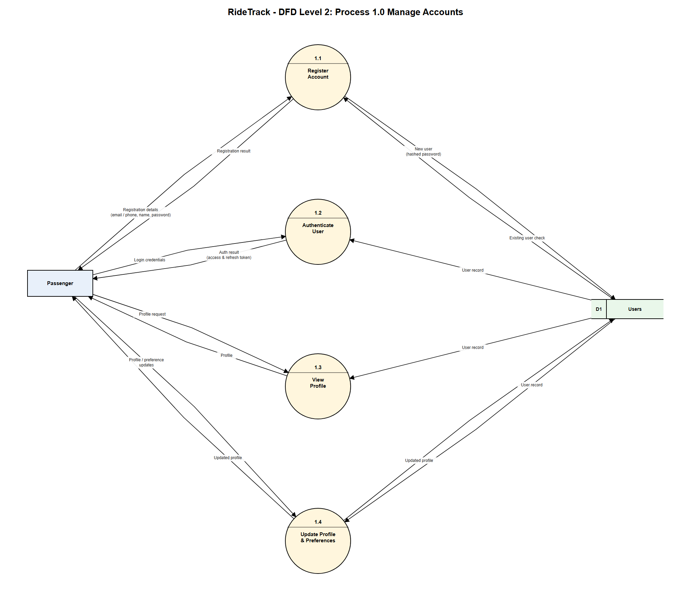

Editable source: page 8 of [`dfd.drawio`](diagrams/dfd.drawio) · PDF: page 8 of [`dfd.pdf`](diagrams/dfd.pdf)

The same flows apply to conductors, inspectors and authority officers, who also log in and manage a profile through this process; the diagram shows the passenger as the typical user.

### Sub-processes

| ID | Sub-process | Description |
|---|---|---|
| 1.1 | Register Account | Takes registration details (email or phone, name, password), checks the user does not already exist in D1, stores the new user with a hashed password, and returns the result |
| 1.2 | Authenticate User | Checks login credentials against the user record in D1 and returns an access and refresh token |
| 1.3 | View Profile | Returns the user's profile and preferences on request |
| 1.4 | Update Profile & Preferences | Applies changes to name, language, notification settings and device push token, and saves them to D1 |

### Data flows

| From | To | Data |
|---|---|---|
| Passenger | 1.1 | Registration details (email / phone, name, password) |
| 1.1 | Passenger | Registration result |
| D1 | 1.1 | Existing user check |
| 1.1 | D1 | New user (hashed password) |
| Passenger | 1.2 | Login credentials |
| 1.2 | Passenger | Auth result (access & refresh token) |
| D1 | 1.2 | User record |
| Passenger | 1.3 | Profile request |
| 1.3 | Passenger | Profile |
| D1 | 1.3 | User record |
| Passenger | 1.4 | Profile / preference updates |
| 1.4 | Passenger | Updated profile |
| D1 | 1.4 | User record |
| 1.4 | D1 | Updated profile |

### Balancing with Level 1

Everything entering or leaving process 1.0 in Level 1 appears in Level 2: registration, login and profile updates from the passenger, the authentication result and profile returned to them, and the reads from and writes to D1.

> Level 1 was updated for this: the passenger's input to 1.0 is now labelled "Registration / login / profile updates", so profile changes (FR12) are visible there.

## Level 2 — Process 6.0 Manage Delays & Alerts

Process 6.0 is expanded into five sub-processes. This covers FR8 (notify passengers of delays, cancellations and route changes).

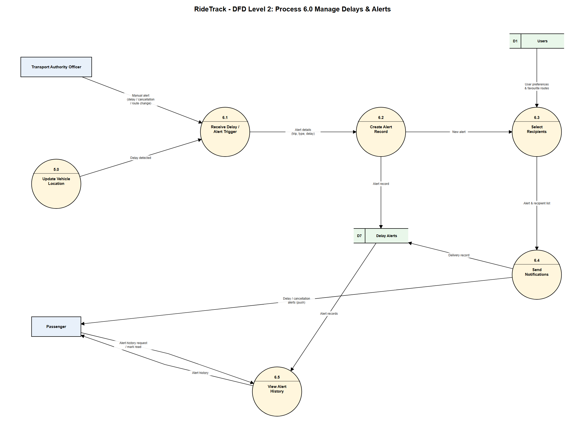

Editable source: page 7 of [`dfd.drawio`](diagrams/dfd.drawio) · PDF: page 7 of [`dfd.pdf`](diagrams/dfd.pdf)

### Sub-processes

| ID | Sub-process | Description |
|---|---|---|
| 6.1 | Receive Delay / Alert Trigger | Accepts an automatic "delay detected" from process 5.0, or a manual alert (delay, cancellation, route change) from an authority officer |
| 6.2 | Create Alert Record | Builds the alert (trip, type, message, delay minutes) and stores it in D7 |
| 6.3 | Select Recipients | Uses user preferences and favourite routes in D1 to choose who should be notified |
| 6.4 | Send Notifications | Pushes the alert to the selected passengers and records delivery in D7 |
| 6.5 | View Alert History | Lets a passenger see past alerts and mark them as read |

### Data flows

| From | To | Data |
|---|---|---|
| 5.0 Update Vehicle Location | 6.1 | Delay detected |
| Transport Authority Officer | 6.1 | Manual alert (delay / cancellation / route change) |
| 6.1 | 6.2 | Alert details (trip, type, delay) |
| 6.2 | D7 | Alert record |
| 6.2 | 6.3 | New alert |
| D1 | 6.3 | User preferences & favourite routes |
| 6.3 | 6.4 | Alert & recipient list |
| 6.4 | Passenger | Delay / cancellation alerts (push) |
| 6.4 | D7 | Delivery record |
| Passenger | 6.5 | Alert history request / mark read |
| D7 | 6.5 | Alert records |
| 6.5 | Passenger | Alert history |

### Balancing with Level 1

Everything entering or leaving process 6.0 in Level 1 appears in Level 2: the delay signal from 5.0, the read of D1, the writes to and reads from D7, and the alerts sent to the passenger.

> Level 1 was updated for this: three flows were added to 6.0 — `Passenger → 6.0` (alert history request), `Authority Officer → 6.0` (manual alert) and `D7 → 6.0` (alert records). Manual alerts are how route changes reach passengers, since automatic detection only covers delays.

## Level 2 — Process 7.0 Monitor Network & Reports (authority reports)

Process 7.0 is expanded into five sub-processes. This covers FR9 (operations dashboard), FR10 (reports and statistics) and the authority's maintenance of routes and schedules.

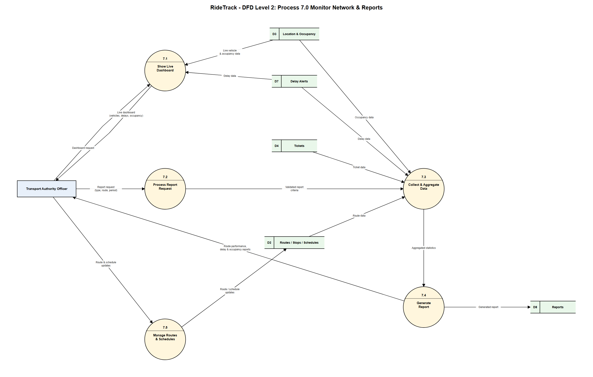

Editable source: page 6 of [`dfd.drawio`](diagrams/dfd.drawio) · PDF: page 6 of [`dfd.pdf`](diagrams/dfd.pdf)

### Sub-processes

| ID | Sub-process | Description |
|---|---|---|
| 7.1 | Show Live Dashboard | Combines live vehicle positions, occupancy (D3) and active delays (D7) into the dashboard shown to the officer |
| 7.2 | Process Report Request | Receives the report request (type, route, period) and validates the criteria |
| 7.3 | Collect & Aggregate Data | Reads occupancy (D3), delays (D7), tickets (D4) and route data (D2) for the chosen period and computes statistics |
| 7.4 | Generate Report | Builds the route performance, delay or occupancy report, saves it to D8 and returns it to the officer |
| 7.5 | Manage Routes & Schedules | Applies the officer's route and schedule changes to D2 |

### Data flows

| From | To | Data |
|---|---|---|
| Transport Authority Officer | 7.1 | Dashboard request |
| 7.1 | Transport Authority Officer | Live dashboard (vehicles, delays, occupancy) |
| D3 | 7.1 | Live vehicle & occupancy data |
| D7 | 7.1 | Delay data |
| Transport Authority Officer | 7.2 | Report request (type, route, period) |
| 7.2 | 7.3 | Validated report criteria |
| D3 | 7.3 | Occupancy data |
| D7 | 7.3 | Delay data |
| D4 | 7.3 | Ticket data |
| D2 | 7.3 | Route data |
| 7.3 | 7.4 | Aggregated statistics |
| 7.4 | D8 | Generated report |
| 7.4 | Transport Authority Officer | Route performance, delay & occupancy reports |
| Transport Authority Officer | 7.5 | Route & schedule updates |
| 7.5 | D2 | Route / schedule updates |

### Balancing with Level 1

Everything entering or leaving process 7.0 in Level 1 appears in Level 2: the officer's requests and updates, the dashboard and reports returned to them, reads from D2, D3, D4 and D7, and writes to D2 and D8.

> Level 1 was updated for this: a `D2 → 7.0` flow, "Route data", was added, since route performance reports need route information.

## Level 3 — Sub-process 2.3 Calculate Upcoming Arrivals (route search)

Upcoming arrivals is the route search step with the most internal logic: it combines timetables with live vehicle positions and falls back to the timetable when a vehicle has no live data. It is drawn as a **Level 3** diagram that expands sub-process 2.3 of the [Level 2 route search diagram](#level-2--process-20-search-routes--track-vehicles-route-search).

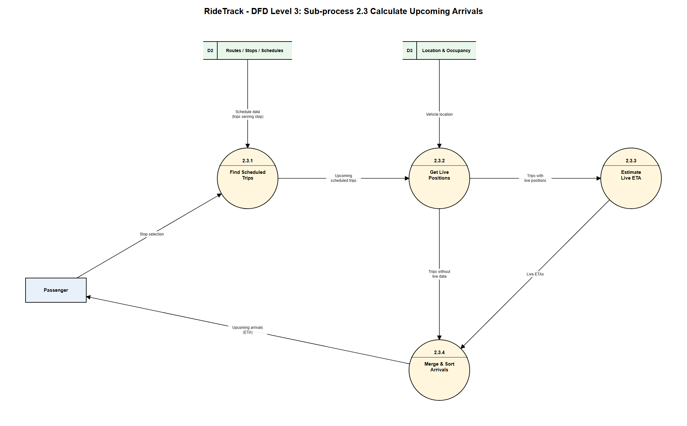

Editable source: page 14 of [`dfd.drawio`](diagrams/dfd.drawio) · PDF: page 14 of [`dfd.pdf`](diagrams/dfd.pdf)

### Sub-processes

| ID | Sub-process | Description |
|---|---|---|
| 2.3.1 | Find Scheduled Trips | For the stop the passenger selected, reads the trips that serve it from the schedule in D2 and keeps the upcoming ones |
| 2.3.2 | Get Live Positions | Looks up each trip's vehicle position in D3 and splits trips into those with live data and those without |
| 2.3.3 | Estimate Live ETA | Estimates arrival time at the selected stop from the vehicle's live position |
| 2.3.4 | Merge & Sort Arrivals | Combines live ETAs with scheduled times for trips without live data, sorts by arrival time and returns the list |

### Data flows

| From | To | Data |
|---|---|---|
| Passenger | 2.3.1 | Stop selection |
| D2 | 2.3.1 | Schedule data (trips serving stop) |
| 2.3.1 | 2.3.2 | Upcoming scheduled trips |
| D3 | 2.3.2 | Vehicle location |
| 2.3.2 | 2.3.3 | Trips with live positions |
| 2.3.2 | 2.3.4 | Trips without live data |
| 2.3.3 | 2.3.4 | Live ETAs |
| 2.3.4 | Passenger | Upcoming arrivals (ETA) |

### Balancing with Level 2

The flows crossing the boundary of 2.3 match Level 2: the stop selection from the passenger, schedule data from D2 and vehicle location from D3 come in, and the upcoming arrivals go back to the passenger. In the app, arrivals from the timetable fallback should be marked as "scheduled" so passengers can tell them apart from live estimates.

## Level 3 — Sub-process 5.3 Calculate ETA (vehicle location)

ETA calculation is the vehicle location step with the most internal logic: it places a raw GPS position on the route and turns it into arrival estimates for the stops ahead. It is drawn as a **Level 3** diagram that expands sub-process 5.3 of the [Level 2 vehicle location diagram](#level-2--process-50-update-vehicle-location).

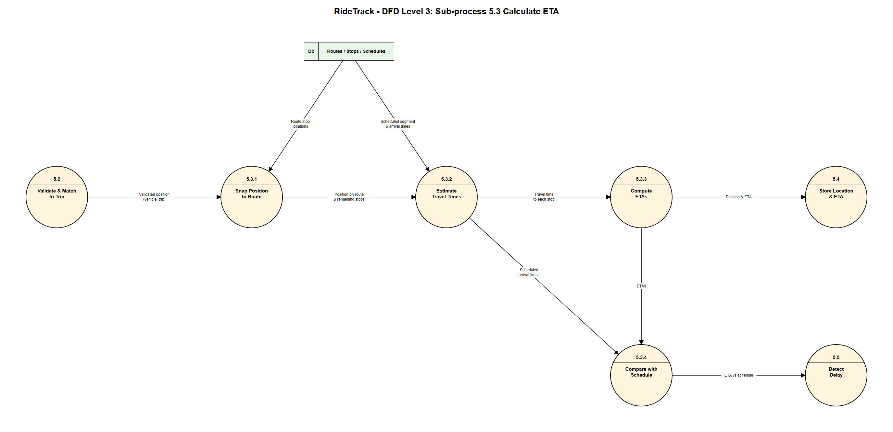

Editable source: page 15 of [`dfd.drawio`](diagrams/dfd.drawio) · PDF: page 15 of [`dfd.pdf`](diagrams/dfd.pdf)

### Sub-processes

| ID | Sub-process | Description |
|---|---|---|
| 5.3.1 | Snap Position to Route | Places the validated GPS position onto the route using the stop locations in D2, giving the vehicle's progress along the route and the stops still ahead |
| 5.3.2 | Estimate Travel Times | Uses the scheduled segment times from D2 to estimate travel time from the vehicle's position to each remaining stop; passes the scheduled arrival times on for comparison |
| 5.3.3 | Compute ETAs | Adds travel times to the current time to give an ETA for each remaining stop, and sends position and ETA to 5.4 for storage |
| 5.3.4 | Compare with Schedule | Compares each ETA with the scheduled arrival time and passes the difference to 5.5, which decides whether the trip is delayed |

### Data flows

| From | To | Data |
|---|---|---|
| 5.2 | 5.3.1 | Validated position (vehicle, trip) |
| D2 | 5.3.1 | Route stop locations |
| 5.3.1 | 5.3.2 | Position on route & remaining stops |
| D2 | 5.3.2 | Scheduled segment & arrival times |
| 5.3.2 | 5.3.3 | Travel time to each stop |
| 5.3.2 | 5.3.4 | Scheduled arrival times |
| 5.3.3 | 5.4 | Position & ETA |
| 5.3.3 | 5.3.4 | ETAs |
| 5.3.4 | 5.5 | ETA vs schedule |

### Balancing with Level 2

The flows crossing the boundary of 5.3 match Level 2: the validated position from 5.2 and the route stops and schedule data from D2 come in (D2's single Level 2 flow is split here into the two parts each step uses), and position and ETA go to 5.4 while the ETA-versus-schedule comparison goes to 5.5.

This design estimates travel times from the schedule. A later version could improve accuracy by also using the vehicle's recent speed from its previous positions in D3; that would add a `D3 → 5.3` read at Level 2.

## Level 3 — Sub-process 4.1 Decode & Verify QR / Ticket ID (ticket scanning)

Ticket scanning is the first step of validation, so it is drawn as a **Level 3** diagram that expands sub-process 4.1 of the [Level 2 validation diagram](#level-2--process-40-validate-ticket--count-riders).

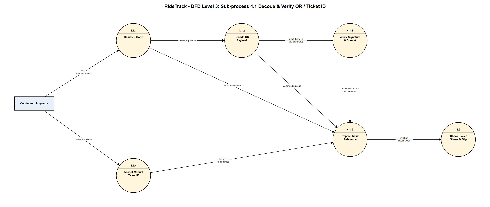

Editable source: page 5 of [`dfd.drawio`](diagrams/dfd.drawio) · PDF: page 5 of [`dfd.pdf`](diagrams/dfd.pdf) (page order: Level 0, Level 1, Purchase Ticket, Validate Ticket, Scan Ticket, Authority Reports, Alerts, User Accounts, Route Search, Vehicle Location, Process Payment, Send Notifications, Check Ticket, Upcoming Arrivals, Calculate ETA)

### Sub-processes

| ID | Sub-process | Description |
|---|---|---|
| 4.1.1 | Read QR Code | Captures the QR from the staff device's camera; an unreadable scan is flagged |
| 4.1.2 | Decode QR Payload | Extracts the token (ticket ID, trip, signature) from the raw payload; a malformed payload is flagged |
| 4.1.3 | Verify Signature & Format | Checks the token's signature and format, so forged or altered QR codes are rejected (this can run on the staff device without a network, supporting NFR10) |
| 4.1.4 | Accept Manual Ticket ID | Fallback when a QR will not scan: takes a typed ticket ID and checks its format |
| 4.1.5 | Prepare Ticket Reference | Combines the outcome of whichever path was used into a ticket reference, or an invalid-token marker, for process 4.2 |

### Data flows

| From | To | Data |
|---|---|---|
| Conductor / Inspector | 4.1.1 | QR scan (camera image) |
| Conductor / Inspector | 4.1.4 | Manual ticket ID |
| 4.1.1 | 4.1.2 | Raw QR payload |
| 4.1.1 | 4.1.5 | Unreadable scan |
| 4.1.2 | 4.1.3 | Token (ticket ID, trip, signature) |
| 4.1.2 | 4.1.5 | Malformed payload |
| 4.1.3 | 4.1.5 | Verified ticket reference / bad signature |
| 4.1.4 | 4.1.5 | Ticket ID / bad format |
| 4.1.5 | 4.2 | Ticket reference / invalid token |

### Balancing with Level 2

The only flows crossing the boundary of 4.1 match Level 2: the staff scan or manual ID comes in, and "ticket ref / invalid token" goes out to 4.2. There are no data stores at this level, because verification uses only the scanned data and the signing key. Failed scans are not dropped: they travel on to 4.2 as an invalid token, and are logged to D6 and reported back to staff by 4.3 and 4.4.

## Level 3 — Sub-process 4.2 Check Ticket Status & Trip (ticket validation)

This is where a scanned ticket is judged valid or invalid. It is drawn as a **Level 3** diagram that expands sub-process 4.2 of the [Level 2 validation diagram](#level-2--process-40-validate-ticket--count-riders).

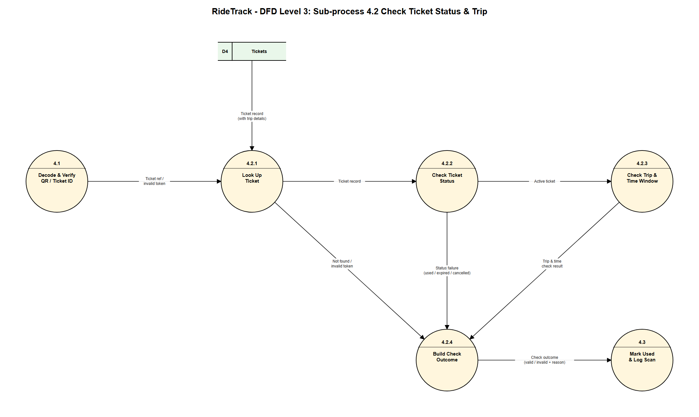

Editable source: page 13 of [`dfd.drawio`](diagrams/dfd.drawio) · PDF: page 13 of [`dfd.pdf`](diagrams/dfd.pdf)

### Sub-processes

| ID | Sub-process | Description |
|---|---|---|
| 4.2.1 | Look Up Ticket | Finds the ticket in D4 using the reference from 4.1; an unknown ticket or an invalid token goes straight to 4.2.4 |
| 4.2.2 | Check Ticket Status | Accepts only `ACTIVE` tickets; `USED`, `EXPIRED` or `CANCELLED` tickets fail with that reason |
| 4.2.3 | Check Trip & Time Window | Checks that the trip in the QR token matches the ticket's trip and that the scan falls within that trip's time window |
| 4.2.4 | Build Check Outcome | Combines the result of whichever check finished last into one outcome — valid, or invalid with a reason — for 4.3 |

### Data flows

| From | To | Data |
|---|---|---|
| 4.1 | 4.2.1 | Ticket reference / invalid token |
| D4 | 4.2.1 | Ticket record (with trip details) |
| 4.2.1 | 4.2.2 | Ticket record |
| 4.2.1 | 4.2.4 | Not found / invalid token |
| 4.2.2 | 4.2.3 | Active ticket |
| 4.2.2 | 4.2.4 | Status failure (used / expired / cancelled) |
| 4.2.3 | 4.2.4 | Trip & time check result |
| 4.2.4 | 4.3 | Check outcome (valid / invalid + reason) |

### Balancing with Level 2

The flows crossing the boundary of 4.2 match Level 2: the ticket reference or invalid token from 4.1 and the ticket record from D4 come in, and the check outcome goes out to 4.3. Each failure path stops further checks and goes directly to 4.2.4, so the reason reported to staff is the first check that failed.

The trip check compares the trip in the scanned token with the ticket's own trip and time. Checking that the ticket is for the specific vehicle the staff member is on would need the staff assignment and trip data (D1 and D2), which the current Level 1 and Level 2 diagrams do not route to process 4.0; it can be added later if required.

## Level 3 — Sub-process 3.3 Process Payment (ticket purchase)

Payment is the step of ticket purchase with the most internal logic: a round trip with an external gateway, verification of its response, and success and failure paths. It is drawn as a **Level 3** diagram that expands sub-process 3.3 of the [Level 2 purchase diagram](#level-2--process-30-purchase-ticket).

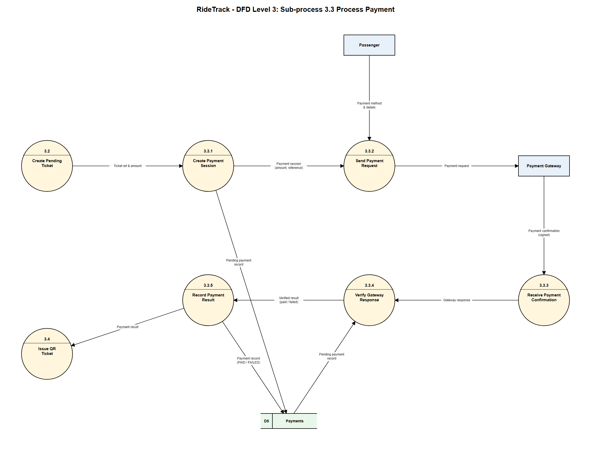

Editable source: page 11 of [`dfd.drawio`](diagrams/dfd.drawio) · PDF: page 11 of [`dfd.pdf`](diagrams/dfd.pdf)

### Sub-processes

| ID | Sub-process | Description |
|---|---|---|
| 3.3.1 | Create Payment Session | Takes the ticket reference and amount from 3.2, creates a payment session and stores a `PENDING` payment in D5 |
| 3.3.2 | Send Payment Request | Sends the payment request to the Payment Gateway; the passenger enters their payment method and details with the gateway |
| 3.3.3 | Receive Payment Confirmation | Receives the gateway's signed confirmation (the gateway's callback / webhook) |
| 3.3.4 | Verify Gateway Response | Checks the signature, then matches the response to the pending payment in D5 (reference and amount), so forged or mismatched confirmations are rejected |
| 3.3.5 | Record Payment Result | Updates D5 to `PAID` or `FAILED` and passes the result to 3.4, which issues the QR ticket only if the payment succeeded |

### Data flows

| From | To | Data |
|---|---|---|
| 3.2 | 3.3.1 | Ticket reference & amount |
| 3.3.1 | D5 | Pending payment record |
| 3.3.1 | 3.3.2 | Payment session (amount, reference) |
| Passenger | 3.3.2 | Payment method & details |
| 3.3.2 | Payment Gateway | Payment request |
| Payment Gateway | 3.3.3 | Payment confirmation (signed) |
| 3.3.3 | 3.3.4 | Gateway response |
| D5 | 3.3.4 | Pending payment record |
| 3.3.4 | 3.3.5 | Verified result (paid / failed) |
| 3.3.5 | D5 | Payment record (PAID / FAILED) |
| 3.3.5 | 3.4 | Payment result |

### Balancing with Level 2

The flows crossing the boundary of 3.3 match Level 2: the ticket reference and amount from 3.2, the passenger's payment details, the request to and confirmation from the gateway, reads and writes of D5, and the payment result to 3.4. The remaining flows are internal to 3.3.

Payment card details are entered with the gateway and are never stored in D5, which keeps only the gateway reference, amount, method and status (see the [database design](06-database-mysql.md)).

## Level 3 — Sub-process 6.4 Send Notifications (alerts)

Sending is the alerts step with the most internal logic: personalising messages, pushing them to devices, recording delivery and retrying failures. It is drawn as a **Level 3** diagram that expands sub-process 6.4 of the [Level 2 alerts diagram](#level-2--process-60-manage-delays--alerts).

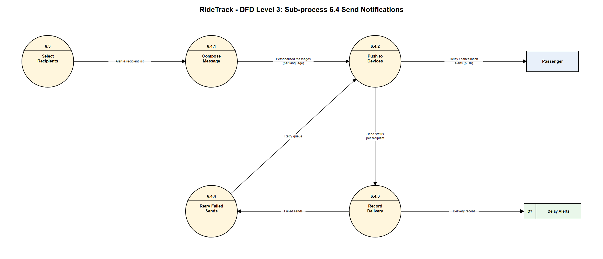

Editable source: page 12 of [`dfd.drawio`](diagrams/dfd.drawio) · PDF: page 12 of [`dfd.pdf`](diagrams/dfd.pdf)

### Sub-processes

| ID | Sub-process | Description |
|---|---|---|
| 6.4.1 | Compose Message | Builds the alert text for each recipient in their preferred language |
| 6.4.2 | Push to Devices | Sends the push notification to each passenger's device (via FCM in the [proposed architecture](05-architecture.md)) and reports a send status per recipient |
| 6.4.3 | Record Delivery | Writes the delivery record for each recipient to D7 (the `alert_recipients` table) and passes failed sends on |
| 6.4.4 | Retry Failed Sends | Queues failed sends (e.g. device offline) and returns them to 6.4.2 for another attempt |

### Data flows

| From | To | Data |
|---|---|---|
| 6.3 | 6.4.1 | Alert & recipient list |
| 6.4.1 | 6.4.2 | Personalised messages (per language) |
| 6.4.2 | Passenger | Delay / cancellation alerts (push) |
| 6.4.2 | 6.4.3 | Send status per recipient |
| 6.4.3 | D7 | Delivery record |
| 6.4.3 | 6.4.4 | Failed sends |
| 6.4.4 | 6.4.2 | Retry queue |

### Balancing with Level 2

The flows crossing the boundary of 6.4 match Level 2: the alert and recipient list from 6.3 comes in, and the alerts to the passenger and the delivery record to D7 go out. The retry loop is internal to 6.4. The push service (FCM) is treated as the delivery channel to the passenger's device rather than a separate external entity, so the Level 0 and Level 1 diagrams stay unchanged.

## Consistency with other diagrams

- The five external entities and their flows in Level 1 add up to the Level 0 flows (Level 0 → Level 1 balancing).
- Data stores D1–D8 correspond to entities in the [ER diagram](02-er-diagram.md): Users ↔ User/Staff/Authority Officer, Routes/Stops/Schedules ↔ Route/Stop/Trip, Location & Occupancy ↔ Location Log/Occupancy Log, Tickets ↔ Ticket, Payments ↔ Payment, Ticket Scans ↔ Ticket Scan, Delay Alerts ↔ Delay Alert, Reports ↔ Report.
