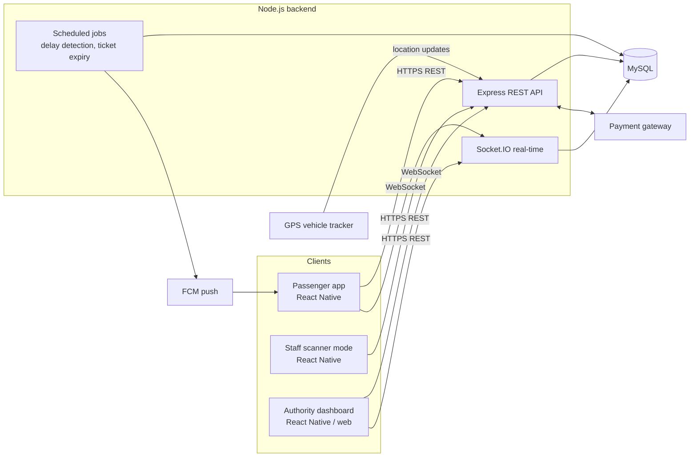

# System Architecture & Tech Stack

> This is the **proposed** design for implementing RideTrack. No code exists yet; the choices below follow the requirements in [01-requirements.md](01-requirements.md).

## Tech stack

| Layer | Technology | Why |
|---|---|---|
| Mobile app | **React Native** (Expo recommended) | One codebase; NFR6 requires Android first, iOS comes free |
| Backend | **Node.js** + Express (REST) + Socket.IO (live updates) | Non-blocking I/O suits many live location updates (NFR2: ≤ 5 s) |
| Database | **MySQL 8** | Relational data with strong integrity (tickets, payments, FKs); see [database](06-database-mysql.md) |
| Auth | JWT (access + refresh tokens), bcrypt password hashing | NFR3, NFR5 |
| Maps | Google Maps via `react-native-maps` | FR4 live map |
| Push notifications | Firebase Cloud Messaging (FCM) | FR8 delay alerts |
| Payments | External gateway (e.g. PayHere for Sri Lanka) | Card data never touches RideTrack (NFR5) |
| QR | `react-native-qrcode-svg` (show), camera scanner (scan) | FR5, FR6 |

## High-level architecture



## Backend structure (Node.js)

Layered by feature: routes → controllers → services → data access.

```
backend/
├── src/
│   ├── app.js                 # Express setup, middleware
│   ├── server.js              # HTTP + Socket.IO bootstrap
│   ├── config/                # env, db pool, constants
│   ├── middleware/            # auth (JWT), role guard, validation, error handler
│   ├── modules/
│   │   ├── auth/              # register, login, refresh
│   │   ├── users/             # profile, preferences
│   │   ├── routes/            # routes, stops, schedules
│   │   ├── vehicles/          # vehicles, location & occupancy ingest
│   │   ├── trips/
│   │   ├── tickets/           # purchase, QR, history
│   │   ├── payments/          # gateway integration + webhook
│   │   ├── scans/             # ticket validation
│   │   ├── alerts/            # delay alerts, notifications
│   │   └── reports/           # authority reports
│   ├── realtime/              # Socket.IO rooms/events
│   ├── jobs/                  # cron: delay detection, expire tickets
│   └── utils/
├── db/
│   └── schema.sql
├── tests/
├── .env.example
└── package.json
```

Suggested libraries: `express`, `mysql2` (connection pool), `jsonwebtoken`, `bcrypt`, `zod` or `joi` (validation), `socket.io`, `node-cron`, `helmet`, `cors`, `express-rate-limit`, `firebase-admin`, `jest` + `supertest`.

## Key flows

**Live tracking (FR4, NFR2)**
1. The vehicle's GPS device (or the driver's phone) POSTs its position to `POST /vehicles/:id/location`.
2. The backend stores it in `location_log` and keeps the latest position cached in memory.
3. It broadcasts to the Socket.IO room `route:<routeId>`; passengers watching that route get the update instantly.

**Ticket purchase (FR5)**
1. App calls `POST /tickets` → backend creates a `PENDING` ticket and a payment session with the gateway.
2. Passenger pays at the gateway; the gateway calls the backend webhook.
3. Backend verifies the signature, marks the payment `PAID`, activates the ticket and generates the `qr_code`.
4. The app caches the ticket locally so it stays scannable offline (NFR10). The QR carries a signed token so staff devices can check authenticity without a network connection.

**Ticket validation (FR6)**
1. Staff scans the QR → `POST /scans` with the token.
2. Backend checks signature, trip, expiry and status, writes a `ticket_scan` row and returns `VALID` / `INVALID`; a valid ticket becomes `USED`.

**Delay alerts (FR8)**
A scheduled job compares each ongoing trip's ETA to its schedule; on a delay it inserts a `delay_alert`, fans out `alert_recipient` rows, and sends FCM pushes.

## Security

- Passwords hashed with bcrypt; JWT access token (short-lived) + refresh token.
- Role-based access control: `PASSENGER`, `STAFF`, `AUTHORITY`.
- QR token is signed (HMAC/JWT) and bound to ticket + trip, so screenshots of someone else's used ticket fail validation.
- All traffic over HTTPS; parameterised SQL queries only; rate limiting on auth and scan endpoints.
- Payment details stay with the gateway; RideTrack stores only the reference and status.

## Environments & configuration

`.env.example` (backend):

```
PORT=3000
DB_HOST=localhost
DB_PORT=3306
DB_USER=ridetrack
DB_PASSWORD=change_me
DB_NAME=ridetrack
JWT_ACCESS_SECRET=change_me
JWT_REFRESH_SECRET=change_me
QR_SIGNING_SECRET=change_me
PAYMENT_GATEWAY_KEY=change_me
FCM_SERVICE_ACCOUNT=./firebase-service-account.json
```

Never commit real secrets; keep `.env` in `.gitignore`.
