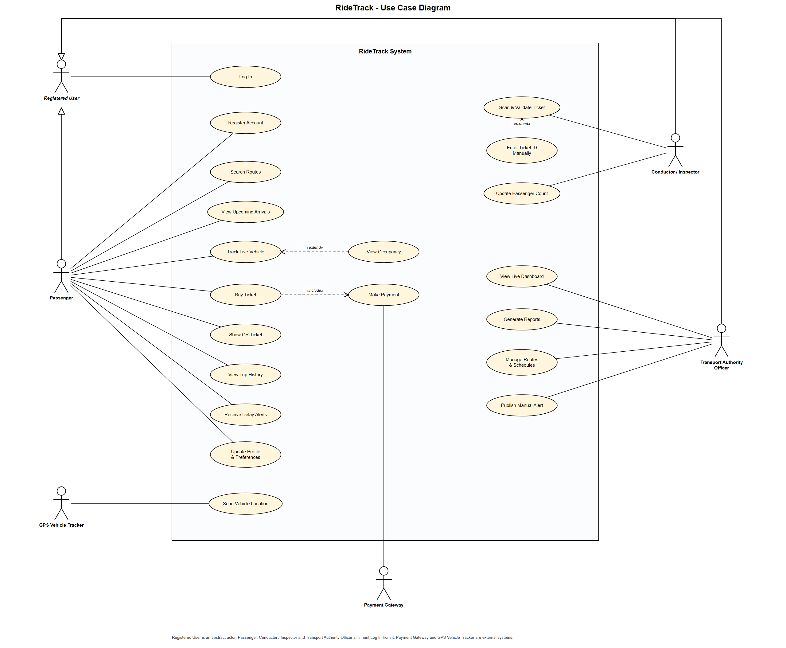

# Use Case Diagram

UML use case diagram for RideTrack, derived from the [requirements](01-requirements.md) and consistent with the [data flow diagrams](03-dfd.md).

Editable source: [`use-case-diagram.drawio`](diagrams/use-case-diagram.drawio) · PDF: [`use-case-diagram.pdf`](diagrams/use-case-diagram.pdf)

**Notation:** stick figures are actors, ovals are use cases, the rectangle is the system boundary. Plain lines are associations; dashed arrows are «include» / «extend» relationships; a line with a hollow triangle is generalization (inheritance between actors).

## Actors

| Actor | Type | Description |
|---|---|---|
| Registered User | Abstract (primary) | Any user with an account; exists so all user types share **Log In** |
| Passenger | Primary | Commuter, student, occasional traveller or tourist using the app |
| Conductor / Inspector | Primary | Bus conductor or train ticket inspector who validates tickets |
| Transport Authority Officer | Primary | Back-office operations user (e.g. NTC, Sri Lanka Railways) |
| Payment Gateway | Secondary (external system) | Processes ticket payments |
| GPS Vehicle Tracker | Secondary (external system) | Device on each bus or train that reports its position |

Passenger, Conductor / Inspector and Transport Authority Officer are specialisations of Registered User.

## Use cases

| Use case | Actor(s) | Requirement | DFD process |
|---|---|---|---|
| Log In | Registered User (all user types) | FR2 | 1.2 |
| Register Account | Passenger | FR1 | 1.1 |
| Update Profile & Preferences | Passenger | FR12 | 1.3, 1.4 |
| Search Routes | Passenger | FR3 | 2.1, 2.2 |
| View Upcoming Arrivals | Passenger | FR3 | 2.3 |
| Track Live Vehicle | Passenger | FR4 | 2.4 |
| View Occupancy | Passenger (extends Track Live Vehicle) | FR7 | 2.4 |
| Buy Ticket | Passenger | FR5 | 3.1, 3.2, 3.4 |
| Make Payment | Payment Gateway (included by Buy Ticket) | FR5 | 3.3 |
| Show QR Ticket | Passenger | FR5, NFR10 | 3.4 |
| View Trip History | Passenger | FR11 | 3.5 |
| Receive Delay Alerts | Passenger | FR8 | 6.4, 6.5 |
| Scan & Validate Ticket | Conductor / Inspector | FR6 | 4.1–4.4 |
| Enter Ticket ID Manually | Conductor / Inspector (extends Scan & Validate Ticket) | FR6 | 4.1.4 |
| Update Passenger Count | Conductor / Inspector | FR7 | 4.5 |
| View Live Dashboard | Transport Authority Officer | FR9 | 7.1 |
| Generate Reports | Transport Authority Officer | FR10 | 7.2–7.4 |
| Manage Routes & Schedules | Transport Authority Officer | — (supports FR3, FR4) | 7.5 |
| Publish Manual Alert | Transport Authority Officer | FR8 | 6.1 |
| Send Vehicle Location | GPS Vehicle Tracker | FR4 | 5.1–5.5 |

## Relationships

| Relationship | Meaning |
|---|---|
| Buy Ticket «include» Make Payment | Every ticket purchase always involves a payment |
| View Occupancy «extend» Track Live Vehicle | Occupancy is shown during tracking only when the vehicle reports it ("where available", FR7) |
| Enter Ticket ID Manually «extend» Scan & Validate Ticket | Manual entry is used only when a QR code will not scan |
| Passenger / Conductor / Authority → Registered User | Generalization: each user type inherits Log In |

## Use case specifications

### UC-01 Buy Ticket

| | |
|---|---|
| **Actor** | Passenger (primary), Payment Gateway (secondary, via Make Payment) |
| **Precondition** | Passenger is logged in |
| **Trigger** | Passenger chooses to buy a ticket for a trip |
| **Main flow** | 1. Passenger selects a trip, boarding stop and alighting stop. 2. System checks the trip and shows the fare. 3. Passenger confirms the purchase. 4. System creates a pending ticket. 5. **Make Payment** (include): passenger pays through the Payment Gateway. 6. System verifies the payment confirmation, activates the ticket and generates its QR code. 7. System shows the QR ticket and stores it on the device for offline use. |
| **Alternative flows** | 2a. Trip is full, cancelled or already departed: system explains and the use case ends. 5a. Payment fails or is cancelled: ticket stays unpaid, no QR is issued, passenger may retry. |
| **Postcondition** | An active ticket with a QR code exists and a payment record is saved |
| **Requirements** | FR5, FR11, NFR5, NFR7, NFR10 |

### UC-02 Scan & Validate Ticket

| | |
|---|---|
| **Actor** | Conductor / Inspector |
| **Precondition** | Staff member is logged in on a staff device |
| **Trigger** | A passenger presents a QR ticket |
| **Main flow** | 1. Staff scans the QR code. 2. System decodes the code and verifies its signature. 3. System checks the ticket is active, not expired and for this trip. 4. System marks the ticket as used and logs the scan. 5. System shows **VALID**. |
| **Alternative flows** | 1a. **Enter Ticket ID Manually** (extend): QR will not scan, staff types the ticket ID. 2a/3a. Signature invalid, ticket unknown, used, expired or for another trip: system logs the scan and shows **INVALID** with the reason. |
| **Postcondition** | Scan is logged; a valid ticket is marked used and the passenger count is updated |
| **Requirements** | FR6, FR7 |

### UC-03 Track Live Vehicle

| | |
|---|---|
| **Actor** | Passenger |
| **Precondition** | Vehicles on the route are sending GPS data (Send Vehicle Location) |
| **Trigger** | Passenger opens the live map for a route |
| **Main flow** | 1. Passenger selects a route. 2. System shows vehicles on the map with ETA to the passenger's stop. 3. System keeps updating positions and ETAs (target: within 5 seconds, NFR2). |
| **Extension** | **View Occupancy** (extend): where the vehicle reports a passenger count, the system shows how full it is. |
| **Alternative flows** | 2a. No live data for a vehicle: system shows the scheduled time, marked as "scheduled". |
| **Requirements** | FR4, FR7, NFR2 |

### UC-04 Generate Reports

| | |
|---|---|
| **Actor** | Transport Authority Officer |
| **Precondition** | Officer is logged in |
| **Main flow** | 1. Officer chooses report type (route performance, delay or occupancy), route and period. 2. System validates the criteria. 3. System collects and aggregates ticket, delay and occupancy data. 4. System generates the report, saves it and shows it to the officer. |
| **Alternative flows** | 2a. Invalid period or no data: system tells the officer and asks for new criteria. |
| **Requirements** | FR10 |
